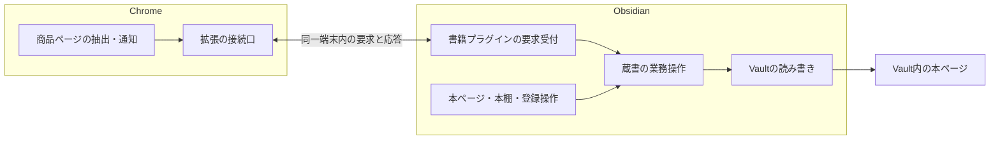

# アーキテクチャ

Chromeの商品ページで所有と購入希望を確認・登録し、ObsidianのVaultに本と版を記録する。[要件](requirements.md)を正本とし、承認した振る舞いと実際に検証した範囲を区別する。

Chrome拡張とObsidianプラグインを同じ端末で動かす。旧サーバー、Web管理画面、データベース、独立したワーカーとその配備は必要ない。

## 採用した構成

**Chrome側**は、商品ページから照合に必要な情報を取り、要求を送り、返った結果を表示する。サイト固有の抽出、Chromeの通信・権限、利用者への通知を担当し、Vaultのパス、Markdownの構造、同じ版かどうかの規則を知らない。独立したWeb管理画面は置かない。

**Obsidian側**では、プラグインがChromeからの受付とObsidian内の操作を同じ業務処理へつなぎ、ObsidianのVault APIで読み書きする。`core` は本・版・所有・購入希望の判断と、業務操作として何を読み、いつ確定するかを担う。Obsidian API、Markdownの構造、通信の型を `core` に渡さない。

**公開契約**は、Chrome の要求と応答を定め、`core` の内部表現から独立させる。
両側が同じ検証スキーマを使い、型はそのスキーマから導く。
業務操作の独立した入出力への変換は境界で行う。
ループバックの待ち受けはプラグインの稼働に従い、独立したサーバーとして配備・運用しない。

本・版・所有・購入希望は、購入時に同時に変更するため、一つの蔵書コンテキストで扱う。本棚と読書記録は同じ本を使う。ブラウザとObsidianの数だけ業務コンテキストや正本を作らない。

上の責務と依存方向を先に定め、構築時に現行 `architecture-standard` の [skeleton](https://github.com/YukiIto1999/architecture-standard/blob/main/structure/skeleton.md)、[ブラウザ拡張の runtime](https://github.com/YukiIto1999/architecture-standard/blob/main/structure/runtimes/browser-extension/layout.md)、[core](https://github.com/YukiIto1999/architecture-standard/blob/main/structure/core/layout.md)、[公開契約](https://github.com/YukiIto1999/architecture-standard/blob/main/structure/contracts/layout.md) に対応付ける。標準の名前が旧実装と一致しても、旧フォルダを存続させる理由にはしない。

### 実行単位と言語

Chromeの拡張と表示、およびそれを動かすホストには、標準が定める [TypeScript](https://github.com/YukiIto1999/architecture-standard/blob/main/languages/README.md#言語と役割) と [Chromium Manifest V3](https://github.com/YukiIto1999/architecture-standard/blob/main/languages/typescript/chromium.md) を使う。商品ページに触れる処理と資格情報付きの通信は、Chromeの異なる実行コンテキストに置く。

現行標準は、拡張が接続する `core` にRustまたはC#を割り当てており、プラグインの実装言語に合わせて `core` をTypeScriptにする案は、この割当を置き換える逸脱となる。

既存の公式Web Clipperは記事や単語の取り込みに使い続ける。
書籍用の照合と登録を既存のClipper設定へ組み込まず、その取り込み経路も変更しない。

### コードの配置と分担

業務の規則は Rust の [`core/vault`](../core/vault) に集める。商品と本・版の照合、保存する変更の計画と購入の再送の判定、本・版の管理と版の移動、本棚の検索・絞り込み・並べ替え、JSON の書き出しと取り込みの検証がここにある。`core` は時計、乱数、ファイルや通信の入出力を持たず、現在時刻は要求に含めて受け取る。同じ規則を TypeScript 側に複製しない。

Obsidian プラグイン（[`runtimes/obsidian`](../runtimes/obsidian)）は、保存形式（本ページの YAML、ISO 8601 の時刻、購入の `inputHash`）、Vault のファイル操作、Chrome との接続、画面、日本語の照合順序を持つ。本棚の並べ替えでは、プラグインが日本語の照合で決めた順位を `core` に渡し、`core` はその順位で本を並べる。

`core` との境目はプラグインの `src/core/` に一つだけ置き、ここだけが Wasm を読み込む。要求は JSON の文字列で渡し、結果は Rust の型から生成した TypeScript の型の値で受け取る。要求まで型付きの値で渡す方式は、2,000冊・各3版の蔵書で中央値が約1.8倍遅かったため採らない。本棚を開いている間は、本の一覧を `core` に保持したまま問い合わせる。問い合わせのたびに一覧を渡すと1回あたり中央値約53ミリ秒かかり、保持すると0.6〜0.9ミリ秒だった。

プラグインの `src/` は次の層に分ける。読み込みの向きは[依存の検査](../tests/arch/medium/typescript/dependencies.test.mjs)が確かめる。

| 場所        | 役目                                                                                      | 読み込めるもの                                                   |
| ----------- | ----------------------------------------------------------------------------------------- | ---------------------------------------------------------------- |
| `main.ts`   | プラグインを組み立てる                                                                    | すべての層                                                       |
| `core/`     | Wasm の `core` を起動し、呼び出し口を渡す                                                 | `core/`                                                          |
| `catalog/`  | 業務操作を進める。保存形式と、自分が宣言する口（`ports.ts`）を通して Vault を読み書きする | `shared/`、`catalog/`、`adapters/note-format/`。`core/` は型だけ |
| `adapters/` | 保存形式、Vault のファイル、Chrome との接続、書誌の取得、版の移動の控えなど外部との接点   | `shared/`、`adapters/`。`core/` と `catalog/ports.ts` は型だけ   |
| `views/`    | `catalog` と `core` が決めた結果を画面に表示し、操作を受ける                              | `shared/`、`views/`、`catalog/`。`core/` と `adapters/` は型だけ |
| `shared/`   | 層をまたいで使う小さな値の扱い                                                            | `shared/`                                                        |

`obsidian` パッケージは `main.ts`、`adapters/`、`views/` だけが、`yaml` は `adapters/note-format/` だけが使う。Node の組み込みモジュールは、ファイル、接続、書誌の取得を担う決まった `adapters/` のファイルだけが使う。

Chrome 拡張（[`runtimes/chrome`](../runtimes/chrome)）の `src/` では、`composition/` が service worker、商品ページ、ポップアップ、設定画面の入口として他の層を組み立てる。`adapters/` は `chrome.*` と DOM で `extension/` の口を実装し、`views/` は表示を担う。拡張の判断を持つ `extension/` は他の層を読み込まず、`extension/` と `views/` は `chrome.*` を使わない。この向きも同じ依存の検査が確かめる。

パッケージの間では、両方の runtime が公開契約の [`contracts/book-vault`](../contracts/book-vault) と商品ページの抽出の [`libs/book-products`](../libs/book-products) だけを使う。

## Obsidianへの組み込み

[標準のruntime一覧](https://github.com/YukiIto1999/architecture-standard/blob/main/structure/runtimes/README.md#構成)に、Obsidianのような外部アプリのプラグインホストはない。既存の区分に当てはめず、どの規律を適用するかを[標準の例外管理](https://github.com/YukiIto1999/architecture-standard/blob/main/README.md#標準の単一性と例外の管理)に従って記録する。[埋め込みsurface](https://github.com/YukiIto1999/architecture-standard/blob/main/structure/surfaces/embedded/layout.md#組み立てと起動)が定める子プロセスまたはネイティブライブラリを使っても、このホスト区分の判断は残る。

独立した一時Vaultを使い、既存ソースを一切使わずに、試験入力を `core` 相当の小さな関数に渡し、戻り値を `Vault.process` で既存本文を残して追記できるかを確かめた。

| 方式                           | Linux x64の隔離環境で観測したこと                                                                                                                                                                                                     | 採否の判断                                                                                                   |
| ------------------------------ | ------------------------------------------------------------------------------------------------------------------------------------------------------------------------------------------------------------------------------------- | ------------------------------------------------------------------------------------------------------------ |
| プラグインが同梱する子プロセス | Obsidian 1.13.7でRust実行ファイルを起動し、標準入出力で準備と応答を確認した。単独の子はプラグインの無効化で正常終了し、レンダラーの強制終了後にも残らなかった。起動が重なった試行では、先に終了した子が親の終了まで回収待ちになった。 | 個人導入では成立する候補だが、別添の実行ファイルが必要なため[配布条件](#配布条件)を満たさない。              |
| Node-APIネイティブライブラリ   | Obsidian 1.13.7で `.node` の読み込みと呼び出しができた。初期化・停止の契約や他OSへの配布は未確認。                                                                                                                                    | OS・アーキテクチャ別の成果物が必要な点は子プロセスと同じ。プロセスを分けずに載せる必要がなければ優先しない。 |
| RustをWebAssemblyに変換        | Obsidian 1.15.1で、Wasmを `main.js` に含めたプラグインを `main.js` と `manifest.json` だけで読み込み、Node APIや子プロセスなしで結果をVaultに保存した。                                                                               | [配布条件](#配布条件)に沿って、OS別の実行ファイルを同梱せずに配布できる。                                    |

子プロセス案でもChromeはプラグインにだけ接続する。子プロセスはノートを直接読み書きせず、業務操作に必要な読み取りと確定をプラグインへ依頼する。プラグインは対象Vaultと書籍範囲を守ってObsidian APIを呼ぶ。

Linux x64のObsidian 1.13.7で、子プロセスが標準入出力で読み取りを依頼し、初版の所有・改訂版の未所有・購入希望ありを受け取って、購入の保存を依頼するところまで実行した。プラグインは、先に読んだノート全文を `Vault.process` のコールバック内で現在の全文と比較し、不一致なら書き込まず、子プロセスは競合を返した。

| 一時Vaultでの操作                                                                | 実際の結果                                                                                 |
| -------------------------------------------------------------------------------- | ------------------------------------------------------------------------------------------ |
| 読み取り後に変更せず保存                                                         | 同じノートで改訂版が所有となり、購入希望が外れた。初版と読書本文は残った。                 |
| 読み取り後、Obsidianのエディターで追記し、その変更がディスクに反映されてから保存 | 競合。追記後のファイルはバイト単位で変化せず、改訂版は未所有、購入希望はありのままだった。 |
| 読み取り後、外部からノートファイルに追記してから保存                             | 競合。外部変更後のファイルはバイト単位で変化しなかった。実際の同期サービスは使っていない。 |
| 二つの要求が同じ変更前のノートを読み、順に保存                                   | 先に保存した要求だけが確定し、後の要求は競合を返した。                                     |

この先行実験の保存対象は既存ノート一つであり、実際の同期サービス、新規作成、複数ノートの更新は扱っていない。

### 配布条件

[配布要件](requirements.md#公開と配布)に従い、GitHub Releases では Chrome 拡張と Obsidian プラグインを同じ版で添付し、両方をまとめた ZIP と、ストアへそのまま出せるファイルを同じビルドから作る。
ストアに掲載するときにも、業務処理、Vault の保存形式、Chrome との契約や接続方式を変えず、同じプラグイン成果物を使えることを組み込み方式の選定条件にする。

[Community Pluginsの標準配布](https://docs.obsidian.md/plugins/releasing/submit-plugin)でObsidianが取得するのは `main.js`、`manifest.json`、任意の `styles.css` で、個別の実行ファイルや `.node` は含まれない。[公開時の規約](https://docs.obsidian.md/community-directory/developer-policies)では依存の自己インストールも認めていない。別添の子プロセスを前提にすると、そのまま掲載するだけでは動かない。

デスクトップ側の組み込み方式は、Rustの `core` をWebAssemblyとして `main.js` に同梱する方式に絞る。プラグインがChromeとの接続・認証とVaultの読み書きを持ち、`core` が業務判断と確定の指示を持つ。`core` はObsidian API、ファイルパス、プロセスの標準入出力に依存させない。配布先ごとの業務実装や、子プロセスとWasmの二系統は作らない。

Linux x64のObsidian 1.15.1とChromium 154で、`main.js` と `manifest.json` のみを置いた試験プラグインに、実際のManifest V3拡張からループバックで接続した。試験用の書誌とノートを使い、RustからVault読み取り・確定を求める往復を通した。

| 操作                                                                      | 観測した結果                                                                                                             |
| ------------------------------------------------------------------------- | ------------------------------------------------------------------------------------------------------------------------ |
| 初版を所有し「欲しい」がある本を照合し、改訂版を購入登録                  | 「別版所持／欲しい」から「同版所持」になり、同じノートに改訂版の所有が加わった。初版と本文は残り、購入希望だけが外れた。 |
| Vaultを読んだ後、Obsidianのエディターで追記し、ディスク反映後に購入を確定 | 拡張に「競合」と表示し、編集後のノートは変わらなかった。                                                                 |
| 同じノートへの購入要求を二件重ねる                                        | 先に保存した要求だけが確定し、古い読み取り結果で保存しようとした要求は競合となった。                                     |
| 保存直後に応答を切断し、購入希望を付け直して同じ要求を再送                | 拡張は最初に「結果不明」、再送では「確定済み」と表示した。再送による書き込みはなく、付け直した購入希望が残った。         |
| 資格情報なし、書籍範囲外の指定、Obsidian停止後の照合                      | それぞれ「未認証」「範囲外」「確認不能」と表示した。書籍範囲外のノートは変化しなかった。                                 |

この実験は Linux における Obsidian への Wasm 組み込みを示す。Chrome との方式を選んだ根拠は[接続方式の選定](#接続方式の選定)、製品の受け入れは [Release ワークフロー](#標準にない採用と逸脱)を参照。

掲載されれば、対応する端末のObsidian内で検索・インストール・更新確認ができ、配布ファイルを手で置く必要がなくなる。[更新は自動ではない](https://help.obsidian.md/community-plugins#update-plugins)。[Obsidian Syncでのプラグイン同期](https://help.obsidian.md/sync/settings#selective-syncing)は掲載とは別の機能で、インストール済み・有効なプラグインの同期を端末ごとに設定する。

### Wasmでの非同期実行

Obsidian 1.13.7の一時Vaultで、Tokio 1.53.1の `rt`・`sync`・`time` と `async-trait` 0.1.92を `wasm32-unknown-unknown` 向けにビルドし、プラグイン内で実行した。単一スレッドで `yield_now` をはさむ非同期の呼び出しは完了した。一方、Tokioのタイマーを使う経路と、実行可能なタスクがなく通知を待つ経路は、どちらもWasmの `unreachable` で停止した。[TokioのWasm制約](https://docs.rs/tokio/1.53.1/tokio/#wasm-support)にも、タイマーを持たない環境と待機に関する制限がある。

Wasm内でTokioを起動してObsidianの非同期I/Oを待つ構成は採らない。先行実験と同様、プラグインがVault APIを非同期で実行し、Wasmは渡された結果に基づいて業務判断を進める。製品の境界では、期限・取消・停止時の処理と、保存の確定前後で結果を区別できることを確認する。実験で使った `async-trait` を製品で必須にすることや、別のRust executorを採用することは決めていない。

## 記録の表現

一つの本を一つのMarkdownページとして保持し、内容が異なる改訂・増補はその中に別の版として記録する。
紙と電子などの形態だけでは版を分けないため、一つの版が複数のISBNに対応しうる。本と版の内部IDを、書名、ISBN、ファイル名、配置先のパスと同一視しない。
同名の別の本が衝突せず、利用者が書名やファイル名を変えても記録の同一性を保つことが保存形式の条件となる。

本の基本項目にはObsidianのプロパティを使い、自由記述は通常のMarkdown本文に置く。
版の反復部分を扱う編集操作はプラグインで補い、標準のプロパティ編集だけですべての版を扱えるとは約束しない。
YAMLの `book-title`・`book-authors`・`book-wanted`・`book-reading-status`・`book-finished-on` と `tags` はObsidianのプロパティとして扱う。`book-props` の `schema: 1` の下に `book-id`、`editions`、`applied-purchases`、型付きの `custom-fields` を置く。版の `id` と所有、ISBN-13の別名は同じ版の行に置く。新規ファイル名は、使えない記号を全角に置き換えて切り詰めた書名に、本IDから作る符号を括弧で添えた名前とする。符号はUUIDv4の本IDなら先頭の8桁、それ以外の本IDならSHA-256の先頭の8桁で、どの端末でも本IDだけで決まる。同じフォルダに大文字と小文字だけが違う名前を含めて同じ名前があれば、符号を12桁、本ID全体と長くする。ファイル名では識別せず、改名後も内部IDで識別する。更新するのは該当するYAMLだけで、手書きの本文や未知のプロパティを再出力で置き換えない。別DBと永続索引は置かない。

著者の役割は `book-props` の `author-roles`(著者名から役割へのマップ)に置き、著作以外の役割だけを記録する。シリーズは版の行の `series`(`isbn` と `name` の組のリスト)に、ISBNごとに置く。拡張からの登録の後に国立国会図書館サーチを待つ間は、照会するISBNと登録で書いた値を `book-props` の `pending-lookup` に置き、照会を終えると取り除く。中身はcoreだけが読む。どれも省略できるキーなので `schema: 1` のまま読み書きでき、これらのキーを知らない版のプラグインも、読まずに残す。入出力のJSONには `pending-lookup` を持ち込まない。

本の日本十進分類法の番号は、Obsidianのプロパティ `book-ndc` に文字列で置き、番号の3桁が属する要目の名前を `book-ndc-section`(`007 情報科学` のような文字列)に置く。国立国会図書館サーチの応答からは、`xsi:type` が `dcndl:NDC10`・`dcndl:NDC9`・`dcndl:NDC8`・`dcndl:NDC` などの件名を、版(`dcndl:NDC` は版なし)と番号の組のリストとしてそのまま `core` に渡し、どの番号をとるかは `core` が決める。番号は利用者が手で書き換えてよく、Obsidianが数値として書いた番号(`7.64`)も3桁の番号として読む。名前は番号だけから決まる写しで、プラグインが番号を書くとき、本ページが変わったとき、起動時と1時間ごとの保守で番号に合わせて書き直す。名前の表は [`core/vault/data/ndc9`](../core/vault/data/ndc9/) に日本図書館協会のNDC9のデータ(CC BY)から抜き出して置き、`core` がWasmに埋め込む。表は [`tools/scripts/ndc9-labels.py`](../tools/scripts/ndc9-labels.py) で作り直せる。出典は配布物の `THIRD-PARTY-NOTICES.txt` に載せる。どちらのキーも省略できるので `schema: 1` のまま読み書きできる。

標準の感想・実用書メモはBook Propsのコマンドで本文末尾に挿入する。利用者が追加・削除するテンプレートはObsidian標準のTemplatesで管理する。

版ごとの所有、本単位の購入希望、本の読書状態は別々に扱う。購入日、タグ、版の記録があるだけでは所有とみなさない。
本に購入希望があっても、どの版も所有していない場合と、すでに別の版を所有している場合の両方がある。[購入希望と解除](requirements.md#購入希望と解除)を参照。

本と版の識別情報、所有、購入希望、読書状態はVaultに残す。商品ページとの照合結果や本棚の表示はその記録から導く。最初の構成には永続索引を置かず、照合も登録前の判定もVaultの記録を読む。書誌や現在情報の変更を一律に履歴として残さない。

## 照合と保存

サイト別の処理は商品情報の抽出を担当し、同じ情報に対する照合規則をサイトごとに分けない。
所有と希望、本の同一性と版の同一性、確認できない結果と記録がない結果を、それぞれ区別する。
純粋な照合規則と外部への読み書きの責任を分け、ブラウザ側とObsidian側に別々の業務規則を複製しない。

照合では退避中の本を除外する。本を特定するためのISBNは退避中の版からも読むが、所有は有効な版だけで判定する。
書き込む操作では、重複防止のため退避中の本と版も確認する。再登録による上書きや自動復元はしない。

管理対象の記録を解釈できないときは、所持や未登録を表示せず、購入や購入希望の登録も行わない。Chromeには読み取れない記録があることだけを返す。「Obsidianで記録を確認」を選ぶと、Obsidianが対象のノートをソースモードで開き、Vault内のパスと理由を示す。記録は自動で書き換えず、利用者が修正してから商品ページで照合し直す。
開きの区切りを失った場合も、先頭に管理対象のYAMLと識別できる項目が残っていれば、読めない記録として扱う。

登録は最新の記録を読み、対象を決め、変更を保存し、結果を確認してから完了を通知する。
一度の照合に使う本の一覧は、読み取りの前後で更新情報を比較する。
一覧が変わったときは一度だけ読み直し、安定した一覧を得られなければ確認不能にする。
今回の購入と、すでに持っていた版の記録を、所有の有無から推測せず操作として区別する。購入として登録する時は、版の所有と本の購入希望の解除を一つの保存結果として扱う。
二重操作や再送で本と版を増やさず、同じ購入の再送で後から付けた購入希望を解除しない。手修正した書誌、本文、タグ、読書状態を取得情報で上書きしない。
購入の確定を同じ要求で再確認できるよう、要求IDと確定結果を同じ保存に含める。結果不明の要求を別の購入として再送しない。再確認の期限は要求発行から24時間で、7日を超えた確定結果の記録だけを整理する。本や版はこの期限処理の対象ではない。

通常の購入では、所有・購入希望・適用済みの要求IDを同じ本ページの一回の保存で確定する。ChromeとObsidian内の操作を入口によって分けず、正本のVaultごとに、照合から確定までの書き込み操作を一列に並べる。この順序の中で直近の記録から対象を引き直すため、同じ未登録本への二つの要求が別々の本ページを作らない。新規作成先にファイルがあれば上書きせず、対象の同一性から確かめ直す。

保存時は、[競合の判定](requirements.md#直接編集と競合)に従い、操作を引き受けて最初に判断した時点の本・版・状態を、確定直前の記録と照合する。Chromeの商品ページを開いたときの自動照合は、後の更新を許可する根拠にしない。ただし利用者がすでに候補を選んでいる場合は、その選択を保存時にも維持する。再照合で対象が変わったときは別の対象へ書き込まない。

既存ノートでは `Vault.process` が渡す最新の内容から比較し、Wasmには判定に必要な情報だけを渡す。更新可能と判定できたら、最新の原文を土台に変更箇所だけを書き換える。照合に影響しない本文やプロパティの変更を戻したり、古いノート全体を再生成したりしない。意図した箇所以外を変えずに更新できると確認できない場合は書き込まない。

他の本ページは、照合に使った一覧と、`Vault.process` の中でObsidianが認識するパス・ファイルの識別子・更新情報を比較する。違いがあれば、対象ページで観測した競合を先に判定し、変わっていない場合だけ新しい一覧で元の判定と照らし直す。別候補が見つかった場合や、再確認中にも他のページが変わった場合は競合で止める。対象ページの本文だけが変わっても保存を続ける。新規作成では、Vaultに作成を渡す直前に一覧を比較する。

Obsidianの [`Vault.process`](https://github.com/obsidianmd/obsidian-api/blob/737629a51f6b4d30f8336fa3d38f3df006e322d4/obsidian.d.ts#L10397-L10412) が定める原子的な読み書きの単位は、既存ノート一つである。

Obsidian 1.15.1で追加確認したところ、未保存の文字列はエディターにあっても `Vault.process` が受け取る内容にはなかった。この一試行では後の自動保存でエディターとAPIの両方の変更が残ったが、未保存の変更を検知できる証拠にはならない。さらに、`Vault.process` が現在の内容を受け取った直後にObsidian APIを通さず同じファイルを書き換えると、後続の保存がその外部変更を上書きした。したがって `Vault.process` 内の比較だけを、あらゆる直接編集・外部同期に対する上書き防止として採用しない。

対象の本ページに未保存の入力があるかを、保存前に開いている編集ビューとVaultの記録から確認する。未保存の編集が見つかった場合や、対象の最新状態を確認できない場合は、保存せずに確認不能を返す。更新通知がないことだけでエディターの状態を判断しない。

同期が有効でも、最新の状態を確認して競合が見つからなければ保存に進む。最後の比較と保存の間にObsidian APIを経ない書き込みを排除できることは、保存の前提にしない。保存後に接続先のVaultで要求の適用を確認してから完了を返す。再読は要求の適用確認にだけ使い、検出できなかった外部編集まで保持した証拠にはしない。

版の移動では、移動元と移動先の二ページがそろって変わったことを確かめてから成功を返す。
一方だけを確認できた場合は保留とし、移動元の記録から再開できる間は、その記録を使う。
二ページから版が失われる場合に備え、移動する版の全項目を、最初の書き込み前にVaultの外にある端末内のファイルへ保存する。
控えを保存できない場合は、移動を始めない。
控えは端末・Vaultの場所・書籍フォルダごとに分け、版ごとに最新の一件を保持する。
保存先はOSの利用者別データ領域の `BookProps/edition-moves/` 配下で、Windowsでは `%LOCALAPPDATA%` に置く。
移動の成功後も控えを消さない。
控えは書籍の正本ではなく、所有判定、本棚、書籍JSONの対象にしない。
移動元と移動先の両方から版がなくなったときは、「本・版の管理」で控えを確認できる。
利用者が選んだ元のページまたは移動先へ、同じ版IDやISBNがないことを確かめてから復元する。
どちらのページにも戻せない場合は控えをファイルとして保存できる。
控えを作った端末のデータまで失われた場合は、この仕組みでは復元できない。
本棚では、移動が確定するまでは移動元の版を表示し、移動先に書いた仮の版は所有・絞り込み・表示の対象にしない。
未確定の移動は本棚から案内し、管理画面で再開する。
本棚の読み取り中に一覧が変わった場合は、異なる時点の本ページを混ぜて表示しない。

確定の範囲、拒否、結果不明の分類は、[applicationのトランザクション](https://github.com/YukiIto1999/architecture-standard/blob/main/structure/core/application.md#トランザクション)に従い、ファイル操作や通信の実装ではなく業務操作が決める。

## 接続と資格情報

接続時に対象のVaultと書籍の保存範囲を明示し、書籍操作に必要な要求だけを受け付ける。
認証情報は商品ページに渡さず、照合結果の表示に本の本文やVault全体の内容を含めない。
汎用のVault操作用の鍵を使うだけで書籍の範囲に権限が限定されるとは扱わない。

拡張に公開する業務操作は、商品の照合、購入の登録、購入希望の追加・解除、購入結果の再確認、記録または登録画面をObsidianで開く操作に限る。照合には所有の判定と購入希望を別に返す。所持の記録・取消、本棚、版の移動、JSON入出力、アーカイブと復元はObsidian側に置く。

Obsidian は IPv4 ループバックにだけ待ち受けを開く。Chrome 拡張は割り当て済みの固有の `.localhost` 名とポートにだけ WebSocket を開く。外側の WebSocket は TLS のバイナリを運ぶだけで、承認コード、資格情報、業務データは TLS 1.3 の中でやり取りする。待ち受けは接続元アドレス、`Host`、拡張の `Origin`、経路を確認する。これらを相手の認証とは扱わず、[標準の暗号化経路](https://github.com/YukiIto1999/architecture-standard/blob/main/concerns/security/standard-cryptography.md#標準の暗号に任せる)に従い、暗号化前の業務入力や資格情報は送らない。平文や旧版の HTTPS に切り替えない。

受け付ける拡張の ID は事前に登録しない。拡張の ID は配布の経路や読み込んだフォルダで変わり、利用者に写させると誤りの元になるためである。`Origin` は `chrome-extension://` の拡張であることだけを確かめ、セッションは接続用フォルダでコードを証明した拡張の `Origin` に結び付ける。別の拡張がそのトークンを示しても受け付けない。

拡張は、[データの扱いへの同意](requirements.md#データの扱いへの同意)を得るまで商品ページを読まず、Obsidian にも接続しない。同意は扱うデータの版を付けた記録として `chrome.storage.local` に置き、service worker が照合、登録、ペアリング、接続解除の前に毎回確かめて、同意がなければ Obsidian に問い合わせずに「同意が必要」と答える。商品ページの content script は、service worker に同意を尋ねてから読み取りを始める。同意の記録が変わると、service worker は開いているタブに変わったことだけを知らせ、タブは同意を尋ね直す。タブは最後に尋ねた答えだけに従うので、取り消しに追い越された古い答えで読み取りを再開しない。戻る操作でキャッシュから復元されるページは、離れている間の知らせを受け取れない。そのため、ページを離れるときに読み取りを止め、復元されたときに同意を尋ね直す。導入時と、同意のないまま更新されたときは、service worker が設定画面を開く。扱うデータを変える版では記録の版を上げ、利用者に同意し直してもらう。

利用者が Obsidian の設定で接続を始めると、Obsidian 側は Vault と書籍フォルダに対応する接続用フォルダを、書籍や Vault の外に作る。利用者が Chrome のフォルダ選択でこのフォルダだけを承認すると、拡張は Chrome の File System Access API が管理するハンドルを記憶する。商品ページにはハンドルを渡さない。

ブラウザはハンドルを残すが、一時的な許可はブラウザの再起動や拡張の再読み込みで切れる。Vivaldi では、拡張のページをすべて閉じたときにも切れた。許可が切れている間、拡張は接続せず、ポップアップと接続設定で許可し直すよう示す。許可し直すときにブラウザが毎回許可する選択肢を出し、利用者がそれを選んだ場合は、以後は確認なしで接続する。

接続用フォルダはホームの `Book Props` の下に Vault 名で作り、同じ名前のフォルダがあれば `書庫 (2)` のように番号を付ける。[Chromium のフォルダ選択](https://chromium.googlesource.com/chromium/src/+/157.0.8103.79/chrome/browser/file_system_access/chrome_file_system_access_permission_context.cc)は `%APPDATA%` と `%LOCALAPPDATA%` の下を選べず、ドキュメントは同期先へリダイレクトされうるため、ホームの下に置く。設定には識別子とフォルダ名を保存する。再利用するのは、フォルダ名が `Book Props` 直下の一階層を指し、フォルダの接続情報が保存済みの識別子か同じ書籍範囲の識別子を持つときだけである。書籍範囲の一致は、新しい識別子を公開した後に設定を保存できずに終わった場合を自分のフォルダとして扱うためにある。どちらも一致しなければ別の接続のフォルダとして扱い、上書きせずに番号付きの新しいフォルダを作る。

フォルダで共有するのは、ループバック接続先・書籍範囲の識別子・起動中の公開信頼アンカーと、一時コードの SHA-256 検証値だけである。コードは拡張が都度生成し、フォルダから取得したアンカーを使って TLS で接続先を認証してから提示する。Obsidian は現在のアンカーとコードに対応する検証値がフォルダにあり、未使用のときにだけセッションを発行する。検証値を通信資格情報として送ることはできない。

フォルダへの書き込みは接続の権限を与える。Linux では所有者とモードを、Windows では SID と DACL を確認し、保護できないフォルダでは受付を開始しない。同じ OS アカウントで任意のファイルを読み書きできるプログラムや、Chrome・Obsidian 自体の改変に対する隔離ではない。書籍の通信は引き続き TLS 1.3 で行い、接続用フォルダには秘密鍵・コード・セッショントークン・書籍データを置かない。証明書ストアへの登録や専用実行ファイルは不要である。

自動照合や通常の登録でObsidianを前面に切り替えず、明示的に開く操作と区別する。
接続できない場合は確認不能とし、未所有や登録成功に置き換えない。
セッショントークンは拡張の信頼済みコンテキストに限定した `chrome.storage.session` にだけ保持する。Chrome の再起動・プラグイン停止・有効期限切れでセッションがなくなっても、次の操作時に承認済みフォルダの接続先と書籍範囲を確認して新しいセッションを得る。受付を再開できずに接続を始め直すと、同じフォルダで接続の識別子を新しくし、旧識別子で承認したブラウザは自動では接続しない。新しい識別子を保存できなければ旧識別子の接続情報に戻す。書籍フォルダの変更と Obsidian 側の解除では接続用フォルダを削除する。Chrome 側の解除では保存したハンドルとセッションを破棄する。拡張は商品ページから任意の宛先や操作を受け付けず、プラグインは許可操作と入力を検証し、対象が書籍範囲内か確認する。
Chromeの設定画面を開くと、資格情報の有効性をObsidianに問い合わせる。
この問い合わせはVaultを読まず、資格情報が拒否されたときは、問い合わせに使った資格情報だけを破棄する。
応答が得られない場合は、ペアリング済みでも解除済みでもなく、接続を確認できないと表示する。

照合はページ移動・取消・期限切れで打ち切り、古いタブや別の商品に結果を表示しない。購入では、取消や期限切れが書き込み開始前なら未保存とする。書き込みをVault APIに渡した後は、中断や応答切断を取り消し成功と扱わず、確定を観測するまで結果不明とする。正常停止は受付と新たな書き込みを止め、開始済みの保存結果を回収する。強制終了や回収できない場合に確定を推測しない。

同じ購入の再送は同じ要求IDを使う。確定済みのIDはVault内の適用済み記録から元の結果を返し、同じIDを別の入力に使った要求は拒否する。結果不明になったら、同じVault・書籍範囲へ同じIDで書き込まない照会を行う。適用済み記録を見つけられないことを未保存の証拠とはせず、自動で別の購入要求を出さない。適用済み記録は再送を許す最長期間より長く、かつ有限に保持する。
保留には要求を送った接続先と書籍範囲の識別子を残す。
識別子にはVaultの絶対パスと書籍フォルダのSHA-256を使い、パス自体は拡張へ渡さない。
接続先または識別子が異なる場合や、保留に識別子がない場合は、再確認の要求を送らない。
v0.2.0 以前からの更新では、旧設定のホスト名・ポートと、Chrome の保留記録にある接続先・書籍範囲を引き継ぐ。旧セッションや信頼情報は使わず、初回に接続用フォルダを承認して同じ範囲に接続した後にだけ再照会する。
v0.3.0 からの更新では、ホーム直下の `Book Props <識別子>` を削除して新しい接続用フォルダへ移り、ブラウザでのフォルダの選択を一度だけ求める。
v0.4.0 からの更新では、保存済みの拡張 ID を使わずに同じ接続用フォルダと識別子で受付を再開するため、フォルダを選び直さない。拡張の再読み込みで切れた許可だけを求め直す。
保留を手で解除しても購入の結果は確定せず、再登録する前にObsidianの記録を確認するよう案内する。
拡張は、購入、結果の再確認、保留記録の破棄を同時に実行しない。再確認中に別の画面から操作しても、照会中の保留記録や次の購入の記録を変更しない。

### 接続方式の選定

v0.1.0 の HTTPS は使用する Chrome プロファイルへの証明書登録を必要とし、鍵保管が使えない環境では接続を開始できなかった。Native Messaging は [Windows の実 Chrome・Obsidian](https://github.com/YukiIto1999/book-props/actions/runs/45303968237/job/138143972686) で二つの Vault の分離と中継の更新が成立したが、OS ごとの実行ファイルと登録手順が残る。

WebSocket の内側で TLS を使う試験では、[Windows](https://github.com/YukiIto1999/book-props/actions/runs/45303968237/job/138143972686) と [Linux](https://github.com/YukiIto1999/book-props/actions/runs/45308569337/job/138158959091) の実 Chrome と Obsidian で、証明書を登録せずに二つの Vault の異なる記録を取得し、別 Vault と未承認・使用済みのコードを拒否した。Windows では再起動後の旧アンカーと旧コードの拒否、新しい情報での再接続も観測した。Linux の試験では再起動後に試験画面を開けず、この部分は製品の受け入れで確認する。この方式に切り替え、中継や旧 HTTPS は併設しない。

## 書誌取得と対応サイト

[対応サイト](requirements.md#対応サイト)の商品ページ解析と、ISBN・書名で本を探す外部書誌検索は別の入力経路である。
どの経路でも、取得した候補を選択・検証する前に本の記録として保存しない。
URL入力は、商品情報を得る入口として扱い、サイトURLや商品IDを永続的な識別子にしない。

商品ページを開いたChromeと、ObsidianからURLだけを渡す場合の両方で同じ情報を取れるとは限らない。どちらの入力も、商品ページに実際に載る書誌と取得できる範囲から方式を選ぶ。
取得できないURLは、対応するブラウザの経路か手入力へ戻せるようにする。

対応サイトの一覧は拡張の設定画面から開ける。一覧は固定で、各サイトへのリンクを表示する。

ISBNと書名の検索には[国立国会図書館サーチのOpenSearch](https://ndlsearch.ndl.go.jp/help/api)のうち、[国立国会図書館の所蔵資料（`iss-ndl-opac`）](https://ndlsearch.ndl.go.jp/help/api/provider#opac)だけを使う。明示した検索語だけを送り、候補を選ぶまでは書き込まない。書店の商品URLは、ChromeとObsidianで同じサイト別の抽出規則を使う。取得先を対応するHTTPSの商品詳細に限り、リダイレクトは追わない。

## 端末とライフサイクル

ブラウザ側の初期対象はデスクトップChromeであり、接続先Obsidianで利用できる記録を照合する。
スマホでの本ページや読書記録の利用には既存のVault同期を使う設計とし、書籍機能に独自の同期は持たせない。
未同期の端末にだけある変更まで確認したとは扱わず、モバイルの実動確認もデスクトップの成功から推定しない。
プラグインは Node.js でループバック接続を待ち受けるため、Wasm で業務処理を同梱しても[Obsidian のプラグイン規約](https://docs.obsidian.md/community-directory/submission-requirements-for-plugins)上はデスクトップ専用になる。
スマホでは同期済みの Markdown を Obsidian 標準の機能で読んだり編集したりできるが、このプラグインの本棚や登録・編集画面、拡張からの要求受付は動かない。
スマホで専用機能を使うことと、デスクトップ向け成果物を公式配布することは別の判断である。

アーカイブは本ページを移動・削除せず、取り下げた本または版に印を付ける。復元はその印を外す。[要件](requirements.md#入出力と削除)に従い、経過日数による削除処理は持たない。

Obsidian 1.13.7の一時Vaultで、2024年にアーカイブした本がファイルに残り、本棚には出ないことを確認した。本を復元すると「所有 1版／欲しい本」に戻り、版だけをアーカイブすると「所有なし／欲しい本」になった。所有・購入希望の照合と重複登録の拒否は、Wasmを通る登録テストでも確認した。

## 検証

検証の入口は[ルートのNxタスク](../project.json)で、手元、CI、フックが同じタスクを起動する。`pnpm verify`（`verify`）は整形、lint、型、依存の境界、RustとWasmを通る業務・保存、Chrome拡張の購入結果の再確認を検査し、commit の前に手元で、push と PR では [CI](../.github/workflows/ci.yml) で走らせる。`pnpm verify:push`（`verify-push`）は `verify` に成果物の生成と、接続用フォルダとTLSの実結合を加え、push の前に [`.githooks/pre-push`](../.githooks/pre-push) が、版の公開では [Release ワークフロー](../.github/workflows/release.yml)が起動する。どちらも外部バックエンドや書店への通信を前提にしない。全量回帰と mutation の分析は `pnpm verify:full` で別に起動し、commit や push の条件にしない。

入口ごとの所要時間の目標と上限は [`tools/verification-time.json`](../tools/verification-time.json) にだけ置き、pre-push フック、CI、全量回帰と分析のスクリプトが同じ値を読む。目標は構成を見直す目安で、超えても走行は止めない。上限は終わらない走行を止める値で、測った環境、余裕の量と理由を同じファイルに記す。

ブラウザやObsidianでの利用手順は[要件の受入条件](requirements.md#受入条件)で確認する。型検査・成果物生成・Nodeの実結合だけで、実アプリの受入に代えない。

Rustのlintは認知的複雑さが15を超える関数を拒否する。

### 実アプリでの観測

現行の手動導入、再ペアリング、切り戻しは[導入と運用](installation.md)を参照する。以下は実アプリで観測した結果を示す。

Linuxの一時Vaultで、Obsidianの画面から初版の所持、購入希望、本文を入力し、第2版の購入後に同じ一ファイルへ二つの版と本文が残り、購入希望が外れることを確認した。Chromium 154では、Obsidian 1.15.1から発行した未信頼の証明書でペアリングできず、末端証明書を一時プロファイルのNSSに登録してChromeを再起動するとペアリングできた。未認証の照合は `401`、認証済みでも任意の `path` を加えた要求は `400`、認証済みのISBN照合は `200` だった。旧構成の起動や、通常のVault・Chromeプロファイルへの導入はしていない。

同じ構成で、Amazonの[「良いコード／悪いコードで学ぶ設計入門」改訂新版](https://www.amazon.co.jp/dp/4297146223)を開いた。「別版を所持／欲しいに登録済み」の表示から拡張の「購入として登録」を選ぶと、既存ページに改訂新版が増え、初版・本文を残して購入希望が外れた。再照合ではAmazon、[楽天ブックス](https://books.rakuten.co.jp/rb/18048507/)、[バリューブックス](https://www.valuebooks.jp/良いコード／悪いコードで学ぶ設計入門ー保守しやすい成長し.../bp/VS0091667414)、[BOOKOFF](https://shopping.bookoff.co.jp/used/0020488032)の同じISBNの商品が「この版を所持」になった。書店の購入操作はしていない。

既存の版に版名が付いておらず別版か判断できない場合は、拡張の購入操作からObsidianに候補が開いた。選択前のMarkdownは変わらず、「別の版を追加」を選んで保存したときだけ同じページへ版が増え、購入希望が外れた。

編集画面にディスク未反映の文字列を入れて購入要求を送ると確認不能になり、購入希望と適用済み記録は変わらなかった。別の試行では、購入の保存をディスクで確認したうえでChromeへの応答を遮断し、購入希望を付け直した。同じ要求の照会と再送は確定済みを返し、付け直した購入希望を含むMarkdownを1バイトも変更しなかった。プラグインの無効化・再有効化では同じ証明書をOSの鍵保管から取り出し、以前のセッションは `401` で拒否した。
Obsidianを停止して同じ商品ページを再読込すると、「確認できません」と表示され、未所有とは表示しなかった。

Linuxで証明書を更新すると、接続名とポートを維持したまま指紋が変わった。新しい証明書が未信頼の状態では接続できず、旧末端を削除して新末端を登録すると再ペアリングできた。同じペアリングコードの再利用は `401` だった。

Windows 11 Pro 25H2（Obsidian 1.15.1、Chrome 157.0.8103.79）でも、一時Vaultと別のChromeプロファイルに実装成果物を導入した。
初回は未信頼の証明書でペアリングできず、Obsidianの指紋と照合した末端証明書をChromeの「自分でインストール」に登録すると接続できた。
Amazonの同じ改訂新版で「別版を所持／欲しいに登録済み」と表示された後、拡張から購入として記録した。
同じMarkdownに所有する初版と改訂新版が残り、購入希望が外れ、本文は変わらなかった。
再読み込みで「この版を所持」と表示され、拡張の「Obsidianで開く」で保存した本ページが開いた。

証明書を更新すると、接続先名とポートを維持したまま指紋が変わり、DPAPIの旧鍵が除かれて新しい鍵が作られた。
未信頼の新証明書では照合とペアリングが失敗した。
Chromeで旧証明書を削除して新しい末端証明書を登録すると、Chromeを再起動せず再ペアリングでき、同じ商品を「この版を所持」と確認できた。
Windowsではこの一商品で確認し、他の書店と端末間同期は試していない。
上記の Windows・Linux の実測は v0.1.0 の HTTPS 接続を使った記録である。版・所有・保存の業務検証として残し、現行の接続や導入の手順には使わない。

v0.2.0 の公開前試験では、同じ配布 ZIP を [Windows](https://github.com/YukiIto1999/book-props/actions/runs/45330038416/job/138229690599) と [Linux](https://github.com/YukiIto1999/book-props/actions/runs/45330038416/job/138229690727) に展開した。
Chrome 157.0.8103.79 と Obsidian 1.15.1 で、プラグインの有効化、ペアリング情報のコピーと貼り付け、再起動後の再接続、二つの Vault の分離、同じ本ページへの購入希望と所有の記録を確認した。
Chrome のフォルダ選択には、OS のダイアログではなく Chrome の開発者向け API を使った。

Obsidianの画面で、国立国会図書館サーチのISBN検索と書名検索、BOOKOFFの商品URLからの書誌選択、本棚の購入希望・ISBN・数値範囲による絞り込み、項目の表示切り替え、版のアーカイブ・復元と移動、JSON出力と空の書籍フォルダへの取り込みを確認した。独自項目の値 `0` の保存・削除と、既存の本文を残した感想テンプレートの挿入も確認した。JSONには購入結果の再確認記録を持ち込まない。

WindowsのObsidian 1.15.1では、移動先に仮の版が残った一時Vaultを開き、本棚の「所有あり」に移動元だけが1冊・1版と表示されることを確認した。移動先を再開可能な状態に戻して、管理画面から移動を再開すると、同じ版は移動先だけに表示され、Markdownに残るISBNも移動先の1件だけになった。

次の表は、複数の境界にまたがる受入で試す代表例である。

| 前提と操作                                                                                                                                                                              | 観測する結果                                                                                                                                                                         |
| --------------------------------------------------------------------------------------------------------------------------------------------------------------------------------------- | ------------------------------------------------------------------------------------------------------------------------------------------------------------------------------------ |
| 同一端末でChrome拡張と書籍プラグインを有効にし、別途サービスは起動しない。選んだVaultに初版の所有と本の購入希望を記録してから、改訂版と判定できる商品ページで照合し、購入として登録する | 別版所有と購入希望が表示される。Obsidianにフォーカスを移さず、同じ本ページに改訂版の所有が加わり、購入希望が外れ、初版と本文は残る。再照合では同版所有になり、別の本ページは増えない |
| 未認証の接続と、認証済みの拡張から書籍範囲外の要求を試す                                                                                                                                | どちらも対象のデータを返さず、Vaultに変更がない                                                                                                                                      |
| Obsidianを停止した状態で商品ページを開く                                                                                                                                                | 確認不能と表示され、未所有とは表示しない                                                                                                                                             |
| 購入の判断後に購入希望が変更された場合と、本文だけが編集された場合を、[同じ保存経路](requirements.md#保存と競合の条件)で試す                                                            | 前者は競合で書き込まない。後者は新しい本文を保ったまま購入を記録する                                                                                                                 |
| 購入を保存した直後の応答を失い、購入希望を付け直して元の要求を再送する                                                                                                                  | 拡張は応答を失った時点で成否を断定しない。再送後も版は増えず、付け直した購入希望がVaultに残る                                                                                        |
| 正しい証明書、未信頼または名前が異なる証明書、失効済みセッション、またはペアリングとは別のVault・書籍範囲で接続                                                                         | 正しい証明書と有効な範囲の組だけが業務処理へ届く。証明書の検証に失敗した場合は資格情報を送らない                                                                                     |
| [保存と競合の受入条件](requirements.md#保存と競合の条件)に従い、同期を有効にした通常登録、未保存の編集、最終確認前の外部更新、保存後に結果を確認できない購入を試す                      | 同期を止めずに通常登録できる。観測した編集を保持するか、競合・確認不能なら書き込まない。結果不明では成功を返さず、再確認しても新たな書き込みは起きない                               |
| Vault内に存在しない同じ本への新規登録を二つ重ねる                                                                                                                                       | 新規の本ページと版は一つだけになる                                                                                                                                                   |
| 版の移動の途中で停止し、再開する                                                                                                                                                        | 片側だけの変更を成功にせず、版を失わずに解決できる                                                                                                                                   |
| 購入を保存に渡す前と、渡した後に取消またはプラグイン停止を起こす                                                                                                                        | 前者はVaultが変わらず、後者は確定済みか結果不明を区別し、未保存と断定しない                                                                                                          |

通信契約と依存方向は契約・構造の検査で、版の同一性と状態遷移は公開業務操作の検査で押さえる。対応サイト、実店舗からの登録、本棚、版の移動、入出力、アーカイブと復元は[要件の受入条件](requirements.md#受入条件)に従って確認する。

## 標準にない採用と逸脱

準拠の基準は[CONTRIBUTING](../CONTRIBUTING.md#アーキテクチャの標準)が案内する現在の標準本文である。
Obsidian上の保持・記録とブラウザの確認・登録の分担は、利用者が承認した変更先として採用する。
Obsidianには[標準のホスト区分](https://github.com/YukiIto1999/architecture-standard/blob/main/structure/runtimes/README.md#構成)を流用せず、プラグインが組み立て・受付・Vault操作を担う。Obsidian側に限り、[標準の別プロセス・ネイティブライブラリによる組み込み](https://github.com/YukiIto1999/architecture-standard/blob/main/structure/skeleton.md#自己ホストと被ホスト)を、[同一成果物で配布できるWasmの組み込み](#配布条件)に置き換える。標準に沿う方式で別添バイナリや追加インストールなしに同じ運用と配布を満たせるようになった場合、またはWasmで必要な動作と停止の保証が成立しない場合は、この選定を見直す。Chrome拡張内に `core` を組み込まない規律は変えない。

Wasm境界では、[Rustの非同期実行をTokioに固定する規律](https://github.com/YukiIto1999/architecture-standard/blob/main/languages/rust/tokio.md#runtime)に対し、Obsidianの非同期I/Oをプラグイン側で実行する。[実行試験](#wasmでの非同期実行)で、対象のWasm環境ではTokioのタイマーと、タスクが実行可能になるまで待つ使い方が成立しなかったためである。業務判断はプラグインへ複製せず、[Rustの副作用境界](https://github.com/YukiIto1999/architecture-standard/blob/main/languages/rust/connection.md#効果を言語の効果型で表す)との対応を製品の契約で示す。単一成果物のまま標準の実行機構で期限・取消・停止時の回収を保てる場合、またはプラグインへの委譲でこれらを保てない場合は、方式を見直す。

アプリからの書き込みは一つの経路に集める。一方、Obsidianでの直接編集や利用者が選ぶ同期経由の書き込みまで同じ競合制御に通すことは必須にしない。これは、同じ集約へ書く全経路に同じ制御を求める[「整合性を一つの書き込みパスに閉じる」](https://github.com/YukiIto1999/architecture-standard/blob/main/concerns/transaction/single-write-path.md#整合性を一つの書き込みパスに閉じる)に対する例外である。[外部書き込みの実測](#照合と保存)では `Vault.process` が外部更新を上書きした。直接編集と同期方式の自由を維持したまま、外部更新も最終確認から確定まで同じ競合制御に通せるようになれば見直す。

手動導入では、GitHub Releases で配る ZIP を[配布要件](requirements.md#公開と配布)に従って利用者が差し替える。
GitHub Releases は新版を配布するが、展開済みの Chrome 拡張と Obsidian プラグインを同じ版に入れ替える機能は持たない。
初版では[標準の署名検証付き自動更新の規律](https://github.com/YukiIto1999/architecture-standard/blob/main/structure/deploy/layout.md#配備対象と配備先)に対して手動更新を採り、配布物の署名とその検証は省かない。
Obsidian のコミュニティプラグインと Chrome Web Store に掲載すると、両方がそれぞれの仕組みで自動更新される。その場合も Release の添付ファイルを正本とし、ストアには同じファイルを出す。
利用者や更新頻度が増えて手動の差し替えを維持できなくなったとき、または両方を署名検証後に同じ版へ更新できる配布経路を採れるようになったときに見直す。

[CI](../.github/workflows/ci.yml)はブランチの変更と PR に対してルートの `verify` を実行する。
[Release ワークフロー](../.github/workflows/release.yml)は両コンポーネントを一度だけビルドし、手動導入用の ZIP、Obsidian が取得する `main.js` と `manifest.json`、Chrome Web Store に出す拡張の ZIP、依存のライセンスを作る。ZIP 以外は ZIP の中身と同じバイト列であることを梱包後に照合する。
版タグは `0.5.0` のように `v` を付けない。Obsidian が版と同じ名前のタグの Release からプラグインを取得するためである。
ZIP の SPDX SBOM を OSV-Scanner で検査し、Windows・Linux が同じ SHA-256 の ZIP で新規導入、再接続と Vault 保存を確認する。Windows では v0.1.0 の未確定な購入を保持したまま更新し、元の書籍フォルダだけで再照会できることも確認する。
手動起動は受け入れまでで止まり、証明を発行しない。
版タグからの起動では、同じ走行で受け入れた添付ファイルと SBOM を対象に GitHub Actions が署名付きビルド証明を発行する。
証明と添付ファイルのハッシュの照合が通った場合だけ公開し、Immutable Releases が公開版と添付ファイルを証明する。

[標準の Cosign 規定](https://github.com/YukiIto1999/architecture-standard/blob/main/tools/build/cosign.md)に対し、GitHub 上で公開する添付ファイルには、長期の署名鍵を運用せず公開工程を検証できる OIDC 署名を採る。
公開リポジトリの GitHub Actions の署名記録は [Sigstore の公開透明性ログ](https://docs.github.com/en/actions/concepts/security/artifact-attestations#how-github-generates-artifact-attestations)にも残る。
公開ログへの記録を許容できない配布先を追加する場合、または GitHub の証明で公開工程と配布物を照合できなくなった場合は見直す。
運用手順は [CONTRIBUTING](../CONTRIBUTING.md#配布版の準備) に置く。

Chrome と Obsidian は TLS 内の書籍操作に同じ TypeScript の検証スキーマを使う。TLS の Wasm アダプターはバイト列だけを扱い、操作や書籍の型を持たない。TypeScript 以外の利用主体を追加し、同じスキーマを直接使えなくなった場合は、公開契約の供給方法を見直す。
